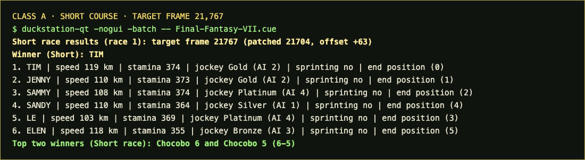

# Frame Race Prototype



An experimental DuckStation fork for testing a selected Final Fantasy VII Chocobo race frame. It loads the class save state, applies the calibrated PSX frame offset, sets the course byte, opens the betting screen, optionally starts the race automatically, and reads the true finish order from game memory.

The runner can operate headless at unlimited speed. It prints the six racers, their stats and end positions, the winner, and the top-two chocobo pair. For Classes B, A, and S it can reload the same checkpoint and run both short and long courses. Class C is short-only.

This is a race runner: it emulates the target frame’s race and reports game results, rather than estimating a winner from speed or jockey rank. It takes a target frame from `0` through `4,194,303`; another tool such as [`psx/`](../psx/) can search the observed stats to find a candidate frame first.

## Sample target frame

The included screenshot is from an actual Class A short-course run at target frame **21,767**. With automatic offset calibration, the runner wrote frame **21,704** (`+63`), then emulated the race and returned:

- Winner: **TIM**
- Top-two bet: **Chocobo 6–5**
- Finish order: TIM, JENNY, SAMMY, SANDY, LE, ELEN

The separate zero-based end positions were `0, 1, 2, 4, 3, 5` in that finish order. The screenshot shows the full output, including racer stats and jockey colors.

## Build

This folder contains source code only; it does not include a DuckStation executable, compiled build directory, game image, BIOS, or save states. On macOS, install Xcode Command Line Tools, CMake, and Ninja. DuckStation also needs its platform dependency pack. Download the macOS dependency archive from [DuckStation's dependencies project](https://github.com/duckstation/dependencies) and extract it so its contents are under `dep/prebuilt/macos-universal/`.

Build the Qt runner from this folder:

```sh
cmake -S . -B build -G Ninja -DCMAKE_BUILD_TYPE=Release -DBUILD_TESTS=OFF
cmake --build build --target duckstation-qt -j4
```

The executable is written to `build/bin/duckstation-qt`.

## Configure and run

In DuckStation's active `settings.ini` (DuckStation → Tools → Open Data Directory), add a `[ChocoPatch]` section. Replace the paths with your local Class A save state and export destination:

```ini
[ChocoPatch]
Enabled=true
StateFile=/path/to/savestates/SCUS-94165_4.sav
UseTargetFrame=true
TargetFrame=21767
FrameOffset=auto
CourseLengthWriteWidth=1
CourseLengthValue=6
CaptureDelayFrames=100
AutoRun=true
RunBothCourses=false
AutoStartDelayFrames=595
ExitAfterCapture=true
Headless=true
ExportPath=/tmp/chocobo-race-results.jsonl
```

Launch with an FFVII disc image (`.cue` or `.chd`):

```sh
build/bin/duckstation-qt -nogui -batch -- "/path/to/Final Fantasy VII.cue"
```

`FrameOffset=auto` uses `+63` for Classes C, B, and A, and `+64` for S. The target frame is reduced by that offset modulo the 4,194,304-frame cycle before it is written to RAM. `CourseLengthValue=6` selects short; `0` selects long. Set `RunBothCourses=true` to run both lengths for B/A/S; the C checkpoint is short-only. `AutoRun=true` starts the race after the betting screen loads, and `Headless=true` suppresses video and audio output. The runner can append a JSON Lines record to `ExportPath`.

The required FFVII image, BIOS, and class save states are not included. The build and output files are ignored by `.gitignore`.
