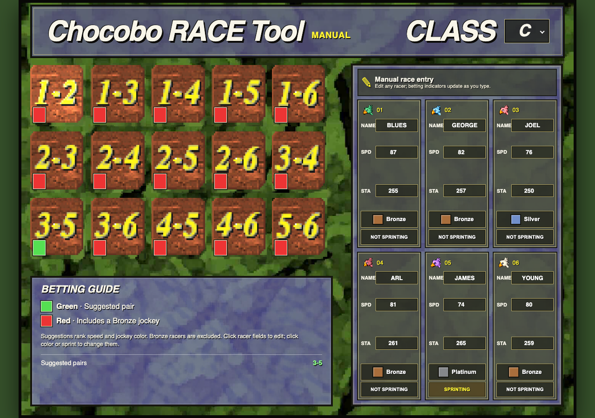

# Chocobo RACE Tool — Manual Mode



Manual-entry version of the PSX race tool. It is useful when you want to enter
racers yourself or use the betting guidance without frame searching, generated
gifts, or automatically generated racer stats.

## Open it

Open `index.html` in a browser, or serve this folder with any static web server.
For example, from the repository root:

```sh
python3 -m http.server 8000
```

Then open `http://localhost:8000/manual/`.

## Use it

- Choose class C, B, A, or S to change the matching game artwork.
- Edit each chocobo's name, speed, and stamina in its card.
- Click a jockey-color swatch to cycle Silver, Gold, Bronze, and Platinum.
- Click the sprint button to toggle sprinting.
- The betting indicators and suggested pairs update as you edit racers.
- Red squares mark bets containing a Bronze jockey. Green squares mark
  suggested pairs among the top three non-Bronze racers; when there are only
  two non-Bronze racers, their pair is the suggestion.

Manual Mode omits frame generation and gift entry. It is a static client-side
page and does not need a backend.
