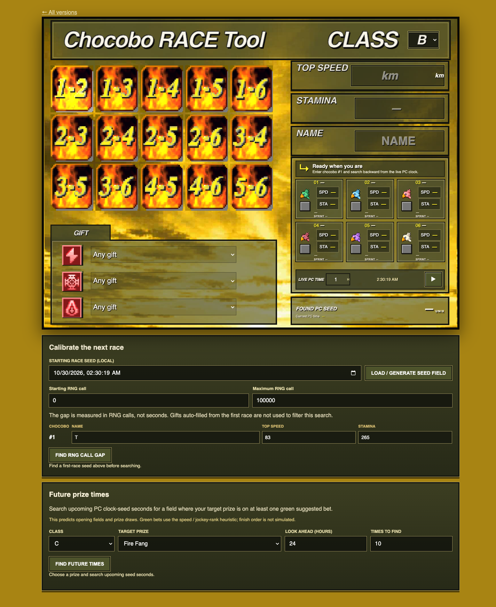

# PC Chocobo Race Predictor



Experimental field and prize predictor for the PC version of Final Fantasy VII.
It is separate from the PSX tool because the PC version seeds its Windows CRT
random number generator from the clock rather than searching a PlayStation
frame counter.

## Open it

Open `index.html` in a browser, or serve this folder with a static web server.
The published version is at <https://ff7man.github.io/pc/>.

## Features

- Search backward from the live PC clock for a matching first chocobo.
- Generate predicted entrants and class C/B/A/S prize draws for a seed.
- Backsolve candidate RNG-call gaps against the next race's first chocobo.
- Search future clock-seed seconds for target prizes on suggested bets.

Bet suggestions use a speed and jockey-rank heuristic. Finish order is not
simulated, and RNG behavior across all race states still needs calibration
against recorded runs.

## Calibration data

[`data/class-c-short-race.md`](data/class-c-short-race.md) records the Class C
short race started at Jan 1, 2023, 12:25:05 PM CST. Add observed winners and
subsequent race fields there to compare predictions and test how later races
continue from the previous race's RNG state.

To reproduce the current Race 1 → Race 2 draw-gap search, run:

```sh
node scripts/search-race-call-gap.js
```

This finds the number of intervening Windows CRT `rand()` calls that matches
the observed second field. It does not simulate the race frame by frame.
