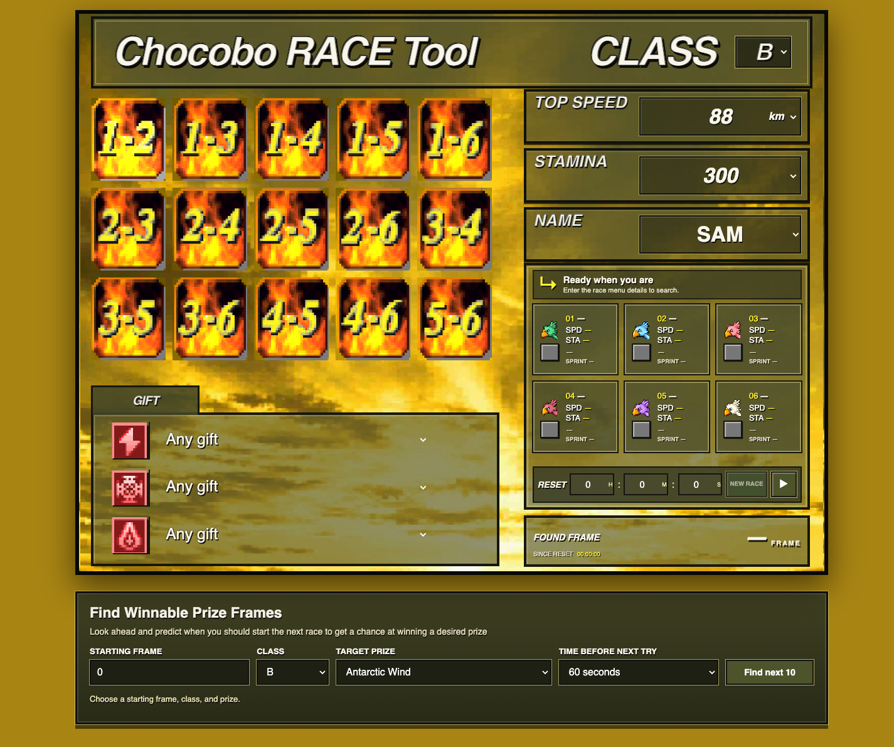

# PlayStation Chocobo Race Finder

Static browser tool for searching FFVII PlayStation Chocobo race frames. It
generates the six-racer field and prizes for a frame, then displays suggested
bet pairs based on top speed and jockey rank.

## Open it

Open `index.html` in a browser or serve this folder with any static web server.
The published version is at <https://ff7man.github.io/psx/>.

## Search for a race

1. Choose class C, B, A, or S.
2. Enter chocobo #1's name, top speed, stamina, and any gifts you know.
3. Enter the time since console reset and start the search.
4. The page scans incrementally, shows progress, and displays all six racers,
   gifts, and suggested bet tiles when it finds a match.

Gift selectors default to **Any gift**. Selecting one filters that prize slot;
any unselected slots are filled from a matching race. Duplicate gift selections
trigger a confirmation because they may indicate an incorrect observation.

The starting time is converted at 60 frames per second. The game counter is an
unsigned 32-bit value, so searches wrap across the full 2^32-frame cycle
(4,294,967,296 frames, about 828 days at 60 fps). If no match is found after
24 hours of searched frames (5,184,000 frames), the page pauses and asks
whether to continue. It asks again after each additional 24 hours. Searches
can be stopped at any time. The green squares are suggestions based on speed
and jockey rank, with Bronze jockeys excluded; they are a heuristic, not a
guaranteed finish-order prediction.

## Winnable prize frames

The **Find Winnable Prize Frames** section searches ahead for frames where the
chosen prize appears on a suggested bet. Its time-before-next-try setting helps
estimate when to start the next race; qualifying frames are listed as they are
found. It also pauses for confirmation after each 24 hours of searched frames.

This folder contains the browser app and artwork. It does not include the
separate DuckStation development source or build artifacts.
