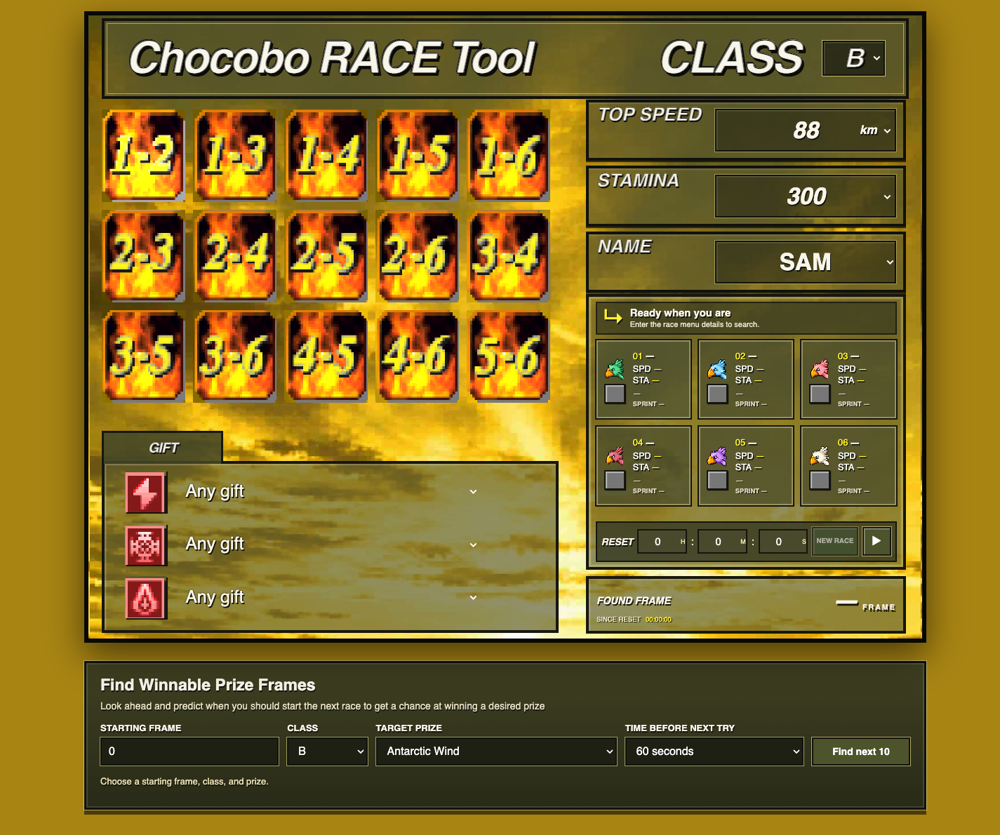

# PSX Computed Winner Lookup



PSX-style race finder that looks up cached long/short winners instead of
launching DuckStation. Enter the observed class, first chocobo stats, and any
known gifts; the app searches for a matching frame, then marks the matching
bet tiles with `L` and `S` from the database.

## Open it

The hosted app is at <https://ff7man.github.io/psxcomputed/>. For local use,
run `./run.sh` from this folder and open <http://127.0.0.1:8766>.

## Rebuild the database

The binary database is in `webapp/data/winners.zip`; the browser unpacks it
with the bundled JSZip library and keeps the decoded data in memory. It stores
only the unordered top-two bet pair for each available class and course, not
the generated names or stats. The seven course pairs per frame use four bits
each (28 bits total), ordered C/B/A/S with short before long; Class C has no
long-course entry. Pair order is deliberately discarded because the UI only
needs the bet tile.

The full-hour race archives are in the repository-level `../data/` folder.
Extract them to a temporary directory and pass that directory to the builder:

```sh
tmpdir=$(mktemp -d)
for rank in c b a s; do
  unzip -p "../data/rank${rank}.csv.zip" "rank${rank}.csv" > "$tmpdir/rank${rank}.csv"
done
python3 build_db.py --input-dir "$tmpdir"
rm -r "$tmpdir"
```

The builder aligns CSV frames to generator seeds by matching all six racers'
stats and names, skips anomalous startup frame 1, and reports detected offset
changes in `winners.json`.

To merge a DuckStation-generated folder after a data run, put it after the old
CSV source and use `--prefer-later-input`, so later emulator winners replace
old results at overlapping aligned seeds:

```sh
python3 build_db.py --input-dir ../ml \
  --input-dir ../psxdatagen/data/<run-folder> \
  --prefer-later-input
```

The packed database stores only the top-two bet pair for each available class
and course. Within each frame, entries are ordered C, B, A, S; short course
before long course; Class C has no long-course entry. Each unordered pair is
encoded as a 4-bit value (15 possible pairs, plus one unavailable marker), so
the seven course results use 28 bits per frame. The old layout reserved six
bytes per frame; the new layout omits unused Class C long-race slots and stores
only what the bet grid needs. Finishing order is not retained. Names and stats
are still generated from the seed by the frame finder. This database does not
simulate finishes or infer missing winner data. Use DuckStation-generated
records to extend coverage and replace historical results where they disagree.

The game takes at least 10 seconds to load the betting screen, so the first 600
frames after reset were intentionally omitted from the generated dataset. The
bundled database covers approximately the following hour, from frame 600
through frame 215,998. C has short-course results only; B, A, and S have both
long- and short-course results. Frames before 600 and frames without imported
winners cannot return a result.

The browser searches the full unsigned 32-bit frame-counter cycle
(2^32 = 4,294,967,296 frames, about 828 days at 60 fps), wrapping from the
maximum frame back to zero. If no match is found after 24 hours of searched
frames (5,184,000 frames), it pauses and asks whether to continue, repeating
the prompt after each additional 24 hours. Winner data is currently available
only for the generated range described above.

Frame matching uses the included `webapp/race_search.c` compiled to
`webapp/race-search.wasm`; JavaScript builds the full race when a seed matches.
To rebuild the module with Emscripten, run this from `webapp/`:

```sh
emcc race_search.c -O3 -s STANDALONE_WASM=1 -Wl,--no-entry \
  -Wl,--export=scan -Wl,--export-memory -o race-search.wasm
```

The browser app and artwork are in `webapp/`. The top-level `index.html`
redirects to the app for convenient folder-level access.
