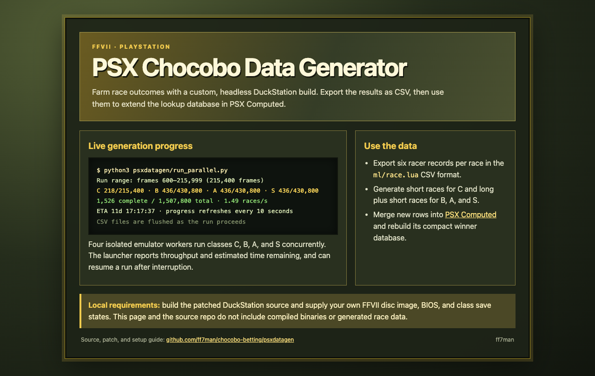

# PSX Chocobo Data Generator



This tool runs a custom DuckStation build to farm PlayStation chocobo race data into CSV files. The CSV format matches the historical `ml/race.lua` data and can be imported into **[PSX Computed](../psxcomputed/)** to expand its cached winner database. No generated race data, emulator build, BIOS, game image, or save states are included here.

## What it generates

For each requested generator frame, DuckStation loads the selected class save state, writes the frame and course selector, opens the betting screen, runs the race at unlimited speed, and appends six racer records. Class C always generates a short race; classes B, A, and S can generate both long and short races.

The CSV columns are:

```text
raceid,ts,rs2,rs1,acc,coop,intel,stamina1,stamina2,sprinting,course,jockey,winorder,pos,name,rank,frame,random
```

The `frame` field is the requested generator frame before the calibrated write correction. `random` is the course RNG byte (`0` long, `6` short). Class C's checkpoint always produces its short course even though the selector byte is `0`.

## Build the custom DuckStation executable

The repo contains a source patch, not a compiled emulator. It is based on DuckStation revision `87bc8379b138860b242d7c7aea299e5872e9ae75` (2026-10-29). Clone that revision, apply the patch, and build it:

```sh
mkdir -p psxdatagen/duckstation
cd psxdatagen/duckstation
git clone https://github.com/stenzek/duckstation.git source
cd source
git checkout 87bc8379b138860b242d7c7aea299e5872e9ae75
git apply ../../duckstation-chocobo-data.patch
cd ..
cmake -S source -B build -G Ninja -DCMAKE_BUILD_TYPE=Release -DBUILD_TESTS=OFF
cmake --build build --target duckstation-qt -j4
```

Install Xcode Command Line Tools and DuckStation's required build dependencies first. The scripts look for the built executable and resources in `duckstation/build/bin/`. They also accept `duckstation/bin/` if you provide a separate runtime there.

## Configure your game files

The runner expects your local DuckStation data in the standard macOS locations:

- BIOS: `~/Library/Application Support/DuckStation/bios/`
- Save states: `~/Library/Application Support/DuckStation/savestates/SCUS-94165_2.sav` through `_5.sav`
- Default game image: `~/Downloads/games/Final Fantasy VII (USA) (Disc 3)/Final Fantasy VII (USA) (Disc 3).cue`

Override the game image with `--game /path/to/disc.cue` or `.chd`. The run uses class C slot 2, B slot 3, A slot 4, and S slot 5. The source runner uses calibrated frame corrections: C +64, B/A +63, and S +64 from requested frame to the value written before race generation.

## Generate or resume a data run

From the repository root, the default command generates frames 600–215,999 for all four classes, skipping the first ten seconds. It creates a timestamped folder under `psxdatagen/data/`, with separate rank CSVs and logs:

```sh
python3 psxdatagen/run_parallel.py
```

Choose a smaller range or another game image like this:

```sh
python3 psxdatagen/run_parallel.py --start-frame 600 --end-frame 10000
python3 psxdatagen/run_parallel.py --game "/path/to/Final Fantasy VII.cue" --output-dir psxdatagen/data/my-run
```

The launcher runs one isolated, headless DuckStation process per class. It reports completed/total races, throughput, and ETA every ten seconds. Stop with Ctrl+C; complete races are flushed to CSV. Resume the latest run after an interruption with:

```sh
python3 psxdatagen/run_parallel.py --resume
```

To resume a specific run folder, pass it after `--resume`. The launcher validates complete six-racer race records, skips completed frame/course pairs, and backs up then removes an incomplete final race before continuing.

## Feed the data to PSX Computed

After a run, build PSX Computed's database using the existing historical CSVs followed by the new run. Later inputs override earlier records for overlapping aligned frames:

```sh
python3 psxcomputed/build_db.py \
  --input-dir ml \
  --input-dir psxdatagen/data/<run-folder> \
  --prefer-later-input
```

The build script realigns rows against the generator and produces the compact winner database used by `psxcomputed/`. Keep the generated CSVs and rebuilt database local unless you intentionally want to publish them.

## Probe the frame-counter wrap

The optional probe writes a requested value to the PSX frame counter, advances a few frames, and prints the observed values around the suspected `0x400000` boundary. It uses the Class C save state and does not save over it:

```sh
python3 psxdatagen/probe_framecounter.py
python3 psxdatagen/probe_framecounter.py --start 4194296 --samples 24
```

## Screenshot and generated files

The screenshot shows an example of the live progress report. Race CSVs, run logs, local DuckStation builds, and worker profiles are generated locally and intentionally excluded from this repository.
