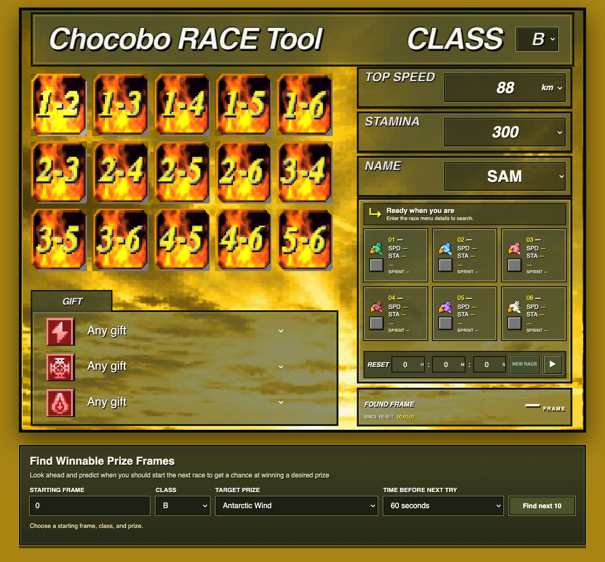

# PSX Chocobo Racer



PSX Chocobo Racer combines the PlayStation frame finder UI with a local DuckStation race runner. Enter the race details from the console; when the finder identifies a matching frame, the page sends that frame and class to DuckStation for a real race simulation.

## How it finds the true winners

The browser searches the PSX frame sequence for the entered chocobo stats and optional gifts. When it finds a candidate frame, the local service passes the frame to the emulator. DuckStation loads the matching class save state, applies the calibrated frame offset, sets the short or long course, then runs the race at unlimited speed. It reads the six finish positions from game memory and returns the actual top-two chocobo pair plus the full race order. The UI marks the winning pair with `S` or `L`.

This is a direct emulation of the race rather than a winner guess based on speed or jockey color. On the tested Mac setup, the race run returns in under two seconds; duration can vary by computer. It supports any valid PSX counter frame from `0` to `4,194,303`. Class C is configured as short-course only; B, A, and S run both course lengths.

## Run locally

1. Build the matching custom DuckStation below.
2. Copy `config.example.json` to `config.json` and set `game_image` to your FFVII `.cue` or `.chd` file. Update the BIOS or save-state directories if yours differ.
3. Start the tool and open <http://127.0.0.1:8765>:

   ```sh
   ./run.sh
   ```

The service listens on `127.0.0.1` only by default. It queues emulator requests so frame, save-state, and result settings cannot overlap. The game image, BIOS, and save states are not included.

## DuckStation settings (managed by the server)

You normally edit only `config.json`; before each race the service writes the relevant `[ChocoPatch]` values into `settings.ini` beside the selected DuckStation executable. It leaves unrelated DuckStation settings alone. The server sets:

| Setting | What it controls |
| --- | --- |
| `Enabled` / `UseTargetFrame` | Enables the patch and uses the requested `TargetFrame`. |
| `StateFile` | Class save slot: C=2, B=3, A=4, S=5. |
| `TargetFrame` | The candidate frame found by the browser search. |
| `FrameOffset` | `auto`: applies the calibrated class offset before writing RAM. |
| `CourseLengthWriteWidth` / `CourseLengthValue` | Writes the course selector as one byte; `6` selects short and `0` long. C uses its short-only checkpoint. |
| `AutoRun` / `AutoStartDelayFrames` | Starts the race automatically after the betting screen settles (595 frames). |
| `RunBothCourses` | Runs short and long for B/A/S; disabled for C. |
| `Headless` / `ExitAfterCapture` | Suppresses video/audio and closes DuckStation when results are captured. |
| `ExportPath` | Temporary JSONL output the server reads and removes after the response. |

The server also sets `CaptureDelayFrames=100`; the automatic start countdown is controlled by `AutoStartDelayFrames`. These settings are generated per request, so configure game, BIOS, and save-state paths in `config.json` instead of editing the runner's `settings.ini`.

## Build the isolated DuckStation runner

This folder contains a source patch, not a compiled emulator. The patch is based on DuckStation revision `87bc8379b138860b242d7c7aea299e5872e9ae75` (2026-10-29). Clone that revision, apply the patch, and build:

```sh
mkdir -p duckstation
cd duckstation
git clone https://github.com/stenzek/duckstation.git source
cd source
git checkout 87bc8379b138860b242d7c7aea299e5872e9ae75
git apply ../../duckstation-chocobo-runner.patch
cd ..
cmake -S source -B build -G Ninja -DCMAKE_BUILD_TYPE=Release -DBUILD_TESTS=OFF
cmake --build build --target duckstation-qt -j4
```

Install Xcode Command Line Tools and DuckStation's required build dependencies. The server uses `duckstation/build/bin/duckstation-qt` and its runtime resources. If you already have a separate runtime at `duckstation/bin/`, the server can use that instead.

## What's included

- `server.py` and `run.sh`: local browser-to-emulator bridge.
- `webapp/`: the PSX-style frame finder and game artwork.
- `duckstation-chocobo-runner.patch`: source changes for target-frame loading, automatic fast races, and finish-order export.
- `config.example.json`: local path configuration template.

Local `config.json`, compiled DuckStation output, BIOS, game images, and save states are excluded from this repository. See the matching source patch and runner notes for implementation details.
